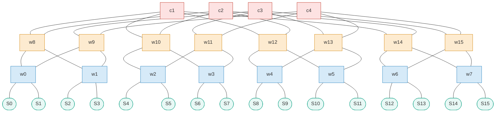
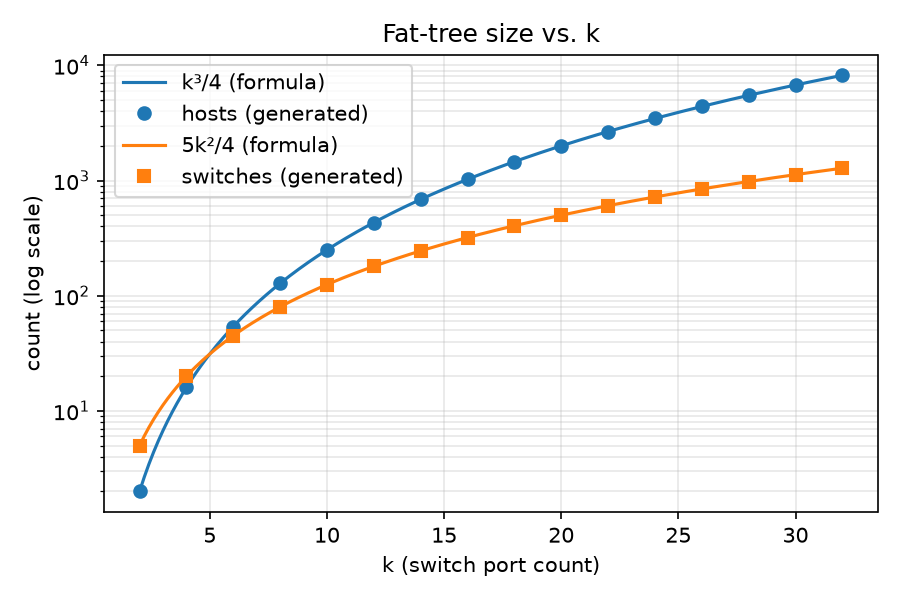
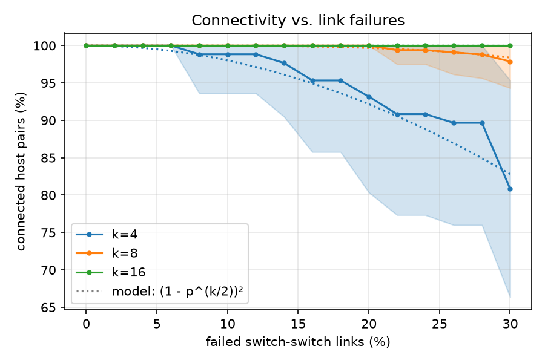
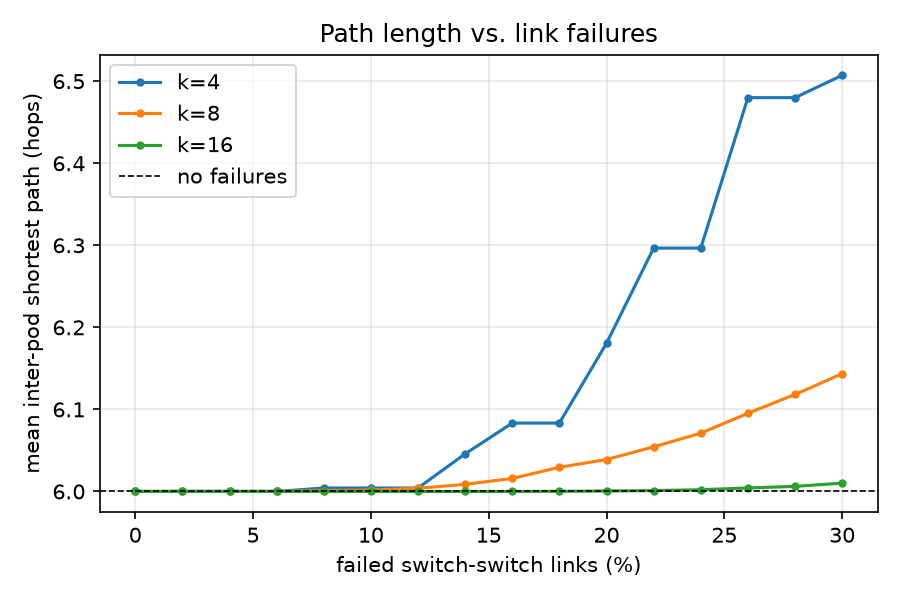
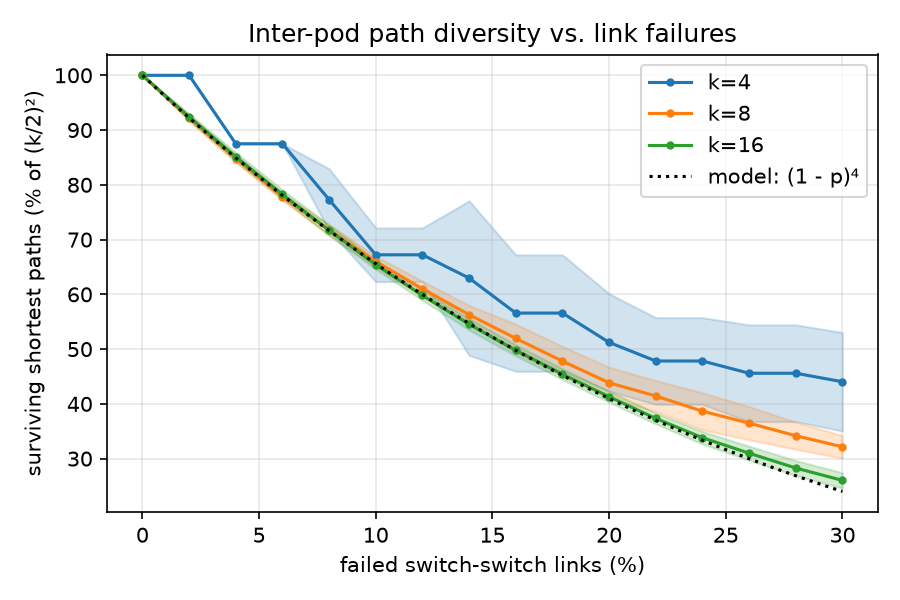

# HW1: Fat-Tree Topology Generation and Analysis

Course 361.2.2460 (Data center networks & AI), Semester A 2026.

A Python tool that generates a k-ary fat-tree data center topology [1], injects random link failures, and measures how the network degrades.

## 1. Background: the k-ary fat-tree

A fat-tree is built from identical k-port switches, where `k` is even.

| Element | Count |
|---|---|
| Pods | k |
| Edge switches per pod | k/2 |
| Aggregation switches per pod | k/2 |
| Core switches | (k/2)² |
| Hosts per edge switch | k/2 |
| **Hosts** | **k³/4** |
| **Switches** | **5k²/4** |
| Switch–switch links | k³/2 |
| Host–edge links | k³/4 |

Wiring:

- Each edge switch connects to its k/2 hosts and to all k/2 aggregation switches in its pod (a full bipartite graph inside the pod).
- Aggregation switch *i* in every pod connects to core switches `i·(k/2)` … `(i+1)·(k/2) − 1`.
- Every switch has degree exactly k.
- Two hosts in different pods have (k/2)² equal-cost shortest paths, each 6 hops long.

Example, k = 4: 4 pods, 2 edge + 2 aggregation switches per pod, 4 core switches, 16 hosts, 20 switches.

Edge switches are `w0`–`w7`, aggregation switches `w8`–`w15`, core switches `c1`–`c4`, and servers `S0`–`S15`. Pod *p* holds edge switches `w2p`, `w2p+1` and aggregation switches `w8+2p`, `w9+2p`. The first aggregation switch of every pod connects to `c1`, `c2`; the second to `c3`, `c4`.



## 2. Run

Set up the environment once as described in the [course README](../README.md#setup), then run from this folder.

Build a fat-tree and print its node and link counts next to the formulas. The metrics block is printed for every run; with no failures every value is at its ideal:

```
$ python fattree.py --k 4
Fat-tree k=4
                actual  formula
hosts               16       16
edge                 8        8
agg                  8        8
core                 4        4
switches            20       20
switch_links        32       32
host_links          16       16
total links         48
all switches have degree k: True
...
```

Fail links and measure the damage, reproducibly:

```
$ python fattree.py --k 8 --failure-rate 5 --seed 42 --trials 10
...
Failures: 5% of switch links -> 12 of 256 removed, 10 trial(s), seed 42
metric                         mean      std   ideal
connected host pairs (%)    100.000    0.000     100
inter-pod path (hops)         6.000    0.000       6
inter-pod shortest paths     13.127    0.082      16
```

Other examples:

```bash
python fattree.py --k 4 --failure-rate 25 --output fattree_k4.json   # export the failed graph (trial 0)
python fattree.py --k 4 --output fattree_k4.edges                    # plain edge list
python fattree.py --experiment all --seed 42                         # all experiments -> results/, figures/
python fattree.py --help
```

## 3. Input parameters

The default value of every option is set in the `CONFIG` block at the top of [fattree.py](fattree.py). A flag given on the command line overrides the value in `CONFIG`. `CONFIG` values go through the same checks as flags, so an invalid value in `CONFIG` is rejected too.

| Flag | Type | Default | Description |
|---|---|---|---|
| `--k` | even int ≥ 2 | required | Switch port count (not needed with `--experiment`) |
| `--failure-rate` | float, 0–100 | 0 | Percentage of candidate links to fail |
| `--failure-scope` | `switch` \| `all` | `switch` | Fail only switch–switch links, or also host links |
| `--seed` | int | random (printed) | RNG seed for failures and host sampling |
| `--trials` | int ≥ 1 | 1 (20 with `--experiment`) | Independent failure draws to average over |
| `--samples` | int ≥ 0 | 64 | Source hosts sampled for path metrics (0 = all hosts) |
| `--output` | path | none | Export the (failed) graph of trial 0: `*.json` = nodes/links/failed links, otherwise an edge list |
| `--experiment` | `hosts` \| `failures` \| `all` | none | Run the experiments of section 5 |
| `--ks` | even ints | 4 8 16 | k values for the failure experiment |
| `--rates` | floats, 0–100 | 0 2 … 30 | Failure rates for the failure experiment |

Validation: `k` must be even and ≥ 2, the failure rate must be in [0, 100], and `--trials` / `--samples` must be ≥ 1 / ≥ 0. Invalid input exits with a usage message.

## 4. Failure model

A failed link is simply removed from the graph. Given a failure rate `p` (in percent), the tool removes exactly `⌊p·|C|⌋` links, chosen uniformly at random from the candidate set `C`. For example, with 1,000 candidate links and `p = 5`, exactly 50 links fail. The same number fail in every trial, so differences between trials come only from *which* links fail. I chose this over independent per-link failures (Bernoulli) because it removes one source of noise: the x-axis value is exact, not an expectation.

By default `C` holds only the switch–switch links. A failed host–switch link disconnects that host entirely, which would dominate every connectivity result and hide what the switching fabric does. `--failure-scope all` also allows host links to fail.

Failures are always applied to a copy of the graph, so the original is never modified. With `p = 0` the graph is unchanged; with `p = 100` (switch scope) only hosts on the same edge switch can still reach each other.

**Reproducibility.** Trial `t` shuffles `C` with seed `"{seed}/{t}"` and removes the first `⌊p·|C|⌋` links. So for a given seed, the links that fail at 10% are a subset of those that fail at 20%. Each curve in section 5 therefore shows the *same* network degrading step by step, which makes the curves smooth and monotone. If no seed is given, one is drawn at random and printed.

**Metrics** (computed per trial, then mean ± std over trials):

- *Connected host pairs*: the exact fraction of all host pairs in the same connected component.
- *Inter-pod path length*: the mean shortest-path length (hops) between connected host pairs in different pods. Ideal: 6.
- *Inter-pod shortest paths*: the mean number of equal-cost shortest paths between those pairs, counted by BFS. Ideal: (k/2)². It is also reported normalized by (k/2)².

The path metrics run a BFS from `--samples` source hosts (sampled once per trial) to all hosts in other pods. With 64 sources at k = 16 that is about 60,000 host pairs per trial.

## 5. Experiments

**Summary of findings:** with only switch–switch links failing, a fat-tree hardly ever loses connectivity, and paths stay 6 hops long. What failures cost is *path diversity*: each inter-pod path uses 4 switch–switch links, so the share of surviving shortest paths follows (1 − p)⁴ for every k. A larger k does not slow this loss down, but it starts from (k/2)² paths, so at 30% failures k = 16 still has about 17 paths per pair while k = 4 is close to a single path and starts to disconnect.

All numbers below come from `python fattree.py --experiment all --seed 42`, which takes about 30 s. Raw data is in [results/](results/) and figures are in [figures/](figures/).

### 5.1 Experiment 1: hosts vs. k (sanity check)

**Question:** does the generated topology match the k³/4 host and 5k²/4 switch formulas?

**Setup:** k ∈ {2, 4, 6, …, 32}, no failures. Measured counts are plotted against the formulas.



**What we see:** every generated count lies exactly on its formula, from 2 hosts at k = 2 to 8,192 hosts and 1,280 switches at k = 32. Link counts and switch degrees (all equal to k) also match; see [results/exp1_hosts_vs_k.csv](results/exp1_hosts_vs_k.csv).

**Why it happens:** each pod contributes (k/2)·(k/2) hosts and there are k pods, which gives k³/4. Hosts grow cubically while switches grow only quadratically.

**Why it matters:** this validates the generator before it is used for anything else. It also shows why fat-trees scale: hosts per switch grow as k/5, so 48-port switches already give 27,648 hosts.

**Reproduce:** `python fattree.py --experiment hosts`

### 5.2 Experiment 2: robustness to link failures (main experiment)

**Question:** how quickly does a fat-tree lose connectivity and path quality as links fail, and does a larger k help?

**Hypothesis (written before running):** path length stays near 6 hops and connectivity stays near 100% until failures get high, because of path diversity. Larger k should be more robust.

**Setup:**

| Parameter | Value |
|---|---|
| k | 4, 8, 16 |
| Failure rate | 0–30%, step 2% |
| Failure scope | switch–switch links only |
| Trials per point | 20 |
| Seed | 42 |
| Host pairs | all pairs for connectivity; BFS from 64 sampled source hosts for path metrics |

Figures show the mean over 20 independent trials. Dotted lines are the analytical models explained below.





**What we see:**

| | k = 4 | k = 8 | k = 16 |
|---|---|---|---|
| Connected pairs at 30% | 80.8% ± 14.5 | 97.9% ± 3.6 | 100% |
| Inter-pod path at 30% (hops) | 6.51 | 6.14 | 6.01 |
| Shortest paths at 10% | 2.69 of 4 (67%) | 10.6 of 16 (66%) | 41.9 of 64 (65%) |
| Shortest paths at 30% | 1.76 of 4 (44%) | 5.1 of 16 (32%) | 16.7 of 64 (26%) |

- **Connectivity** stays at 100% for k = 16 over the whole range, and for k = 8 up to about 24%. k = 4 starts losing pairs at about 10%, with large variance between trials.
- **Path length** stays at 6 hops for k ≥ 8. It only grows for k = 4 (6.5 at 30%), where some pairs have to detour through another pod (8 hops).
- **Path diversity** falls fast and *at the same rate for every k*: about a third of the shortest paths are gone at 10% failures. The measured curves follow the (1 − p)⁴ model closely, especially for k = 16. The k = 4 curve moves in steps because k = 4 has only 32 switch links: each 2% step is 0.64 links, so ⌊p·32⌋ changes only every other step.

**Why it happens:**

- *Diversity:* every 6-hop inter-pod path uses exactly 4 switch–switch links (edge→agg→core→agg→edge), and a path survives only if all 4 survive. So the expected surviving share is (1 − p)⁴, which does not depend on k. For k = 4 the measured share sits *above* the model at high p: pairs that lose all their 6-hop paths either disconnect (and drop out of the average) or fall back to longer paths, which are counted again.
- *Connectivity:* with only switch–switch failures, a host is cut off mainly when its edge switch loses all k/2 uplinks, which has probability about p^(k/2). A pair is connected if neither endpoint is cut off, which gives (1 − p^(k/2))². At p = 30% this is 0.83 for k = 4, 0.98 for k = 8 and 0.99987 for k = 16, matching the measurements. Larger k helps *exponentially* here, because every switch has more uplinks.

**Why it matters:** in a fat-tree, link failures cost **capacity before they cost reachability**. ECMP spreads traffic across all shortest paths, so losing two thirds of them at 30% failures means roughly a third of the inter-pod bandwidth is left, long before any host becomes unreachable. Operators should therefore watch path diversity, not ping reachability. A larger k does not slow the *relative* loss, but it gives far more absolute redundancy: k = 16 at 30% failures still has more paths per pair (≈ 17) than an intact k = 8 network (16).

**Did the results match the hypothesis?** Partly. Connectivity and path length are as robust as predicted, and larger k is clearly more robust for connectivity. But the hypothesis missed that diversity degrades fast and at the same relative rate for every k.

**Reproduce:** `python fattree.py --experiment failures --seed 42` (options: `--ks`, `--rates`, `--trials`, `--samples`)

## 6. Validation

[test_fattree.py](test_fattree.py) covers:

- host, switch and link counts against the formulas, and switch degree = k, for k = 2, 4, 6, 8;
- rejection of odd or too-small k, out-of-range failure rates and invalid `CONFIG` values;
- the failure model: p = 0 leaves the graph unchanged, p = 100 removes every switch link, exactly ⌊p·|C|⌋ links fail, the original graph is untouched, and failures are reproducible and nested;
- metrics on an intact graph (100% connected, 6 hops, (k/2)² paths), and the BFS path counter against `networkx.all_shortest_paths`;
- command-line flags overriding `CONFIG`, and JSON export.

```bash
python -m pytest -q
```

## Layout

```
fattree.py        # CONFIG block, topology, failures, metrics, experiments, plots, CLI
test_fattree.py   # pytest unit tests
results/          # CSVs written by --experiment
figures/          # PNGs written by --experiment, embedded above
README.md
```

Dependencies are listed in `requirements.txt` in the course folder (one level up), shared by all exercises.

## AI usage

Claude (Anthropic) and Gemini (Google) were used to help draft and refine this README from the assignment hints and outline, to implement and verify the topology generator, the failure model, metrics, experiments, and tests, and to audit the analytical models. The generated code and outputs were thoroughly verified against unit tests and closed-form formulas.

## References

[1] M. Al-Fares, A. Loukissas, A. Vahdat. "A scalable, commodity data center network architecture." ACM SIGCOMM 2008.
